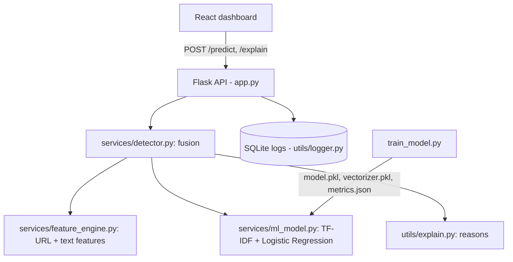

# Cyber Scam Detector: Explainable Phishing Detection Platform

A hybrid phishing/scam detector. A TF-IDF + Logistic Regression model and a rule engine
(URL and social-engineering signals) each score a message; the scores are fused, explained,
and written to an SQLite audit log. React dashboard on top, Flask API underneath.

<!-- TODO: add screenshots (docs/dashboard.png, docs/history.png) and a demo video link -->

## Architecture



## How scoring works

```
risk_score = round(100 * (0.7 * ml_probability + 0.3 * rule_score))
SAFE < 35 <= SUSPICIOUS < 65 <= PHISHING
```

Weights and thresholds live in `backend/config.py` (or env vars `ML_WEIGHT`, `RULE_WEIGHT`,
`MEDIUM_THRESHOLD`, `HIGH_THRESHOLD`). The 0.7/0.3 split is a starting point, not a tuned optimum.
Tune it on a validation set once you have a larger dataset.

**Rule signals:** urgency wording, financial terms, social-engineering phrases; per URL: shortener,
raw IP host, `@`, no HTTPS, suspicious TLD, many subdomains/hyphens, length, bait keywords.

**Explainability:** every response lists plain-English reasons; `/explain` also returns the words
that pushed the model toward scam or safe (coefficient x TF-IDF value) and the raw features.

## API

| Method | Endpoint | Purpose |
| --- | --- | --- |
| POST | `/predict` | Score text `{"text": "..."}`, logs the result |
| POST | `/explain` | Same score plus top model terms and extracted features (not logged) |
| GET | `/health` | Liveness + model loaded |
| GET | `/logs?limit=50` | This device's recent predictions and per-label counts (header `X-Client-Id`) |
| POST | `/feedback` | `{"text", "level", "correct"}` adds a labelled row for retraining |
| POST | `/train` | Retrain with dataset + feedback (header `X-Admin-Token` if `ADMIN_TOKEN` is set) |
| GET | `/status` | Model metrics and fusion weights |

```json
{
  "label": "PHISHING", "level": "HIGH", "risk_score": 91,
  "ml_score": 0.894, "rule_score": 0.96,
  "reasons": ["Urgency-based language detected: urgent, ...",
              "Contains URL shortening service (bit.ly) that hides the real destination",
              "Model confidence is high (89% scam-like)"]
}
```

## Run locally

```bash
# backend (http://localhost:5000); the model trains automatically on first run
cd backend
pip install -r requirements.txt
python train_model.py        # optional: prints evaluation metrics
python app.py
python -m pytest tests       # 7 API/detector tests

# frontend
cd frontend
cp .env.example .env
npm install
npm run dev
```

## Data and evaluation: read this before quoting numbers

The bundled `backend/data/dataset.csv` has 120 rows but only **41 unique messages** (29 spam, 12 ham);
duplicates are removed at training time so they cannot leak between the train and test split.
With that little data the hold-out score (11 messages) is not meaningful, so do not quote it as accuracy.

To get reportable numbers, replace `data/dataset.csv` with a real corpus (for example the
SMS Spam Collection, ~5.5k messages, columns `v1` = ham/spam and `v2` = text; for URL-only
phishing, a PhishTank/Kaggle URL set) and run `python train_model.py`. Report precision/recall on the
scam class and the cross-validated F1 from `models/metrics.json`, not accuracy alone.

Known limitations: English SMS-style text; the model has never seen most real-world brand
impersonation; it cannot check whether a domain is live or newly registered; and a raw-IP link with
otherwise neutral wording can land in SUSPICIOUS rather than PHISHING.

## Privacy note

`/predict` stores the submitted text in `logs.db`. Fine for a demo; for real use, hash or truncate
inputs and add a retention limit.

## Deploy (get it on phones)

The app is an installable PWA: once the frontend is on a public https URL, anyone can open the link on
any phone and add it to the home screen (Android: "Install app"; iPhone Safari: Share, then Add to Home Screen).

1. **Push this folder to a GitHub repo.**
2. **Backend on Render:** New, Blueprint, pick the repo (`render.yaml` is picked up). It trains the model during
   build and starts `gunicorn`. Copy the service URL, e.g. `https://cyber-scam-detector-api.onrender.com`.
   Open `<url>/health`; it should return `{"status":"ok",...}`.
3. **Frontend on Vercel (or Netlify):** import the repo, root directory `frontend`, framework Vite, and set the
   env var `VITE_API_URL` to the Render URL (no trailing slash). Deploy.
4. **Lock CORS:** in Render set `CORS_ORIGINS` to your Vercel URL, e.g. `https://your-app.vercel.app`.
5. **Retrain button:** Render generated an `ADMIN_TOKEN` (Environment tab). Paste it on the Model page to retrain.

Notes: the free Render tier sleeps after ~15 min idle, so the first request can take up to a minute (the app shows a
banner while it wakes). Its disk is ephemeral, so scan history and saved feedback reset on redeploy; attach a
persistent disk or move to Postgres if you need them kept. History is private per device (anonymous id in
localStorage), but message text is still stored on the server; see the privacy note above.

## Stack

Python, Flask, scikit-learn, pandas, SQLite, pytest, React, Vite, Tailwind CSS.
